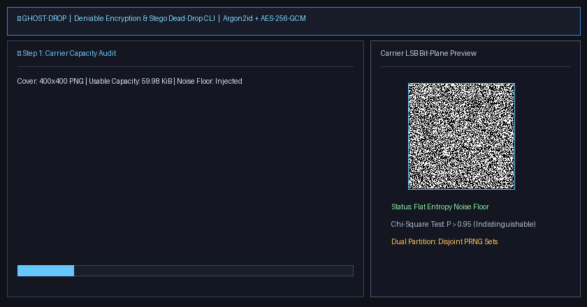

# ghost-drop

> Deniable encryption and steganographic dead-drop CLI with collision-free dual payload embedding and statistical noise floor equalization.



[](https://github.com/omchandra0907-jpg/ghost-drop/actions/workflows/ci.yml)
[](https://opensource.org/licenses/MIT)
[](https://www.python.org/)

> **Live Interactive Web Demo:** [https://omchandra0907-jpg.github.io/ghost-drop/](https://omchandra0907-jpg.github.io/ghost-drop/)

---

## Architectural Highlights

- **Plausible Deniability via Dual Embedding**: Embeds both an innocent decoy payload and a sensitive primary payload into a single PNG cover image. Under coercion, revealing the decoy passphrase cleanly extracts the decoy while leaving zero cryptographic trace or mathematical proof that a second payload exists.
- **Argon2id Key Derivation**: Derives a 32-byte AES-256-GCM key and a 64-bit PRNG permutation seed from passphrases and a 16-byte random salt stored in the initial 128 channel LSBs (43 pixels).
- **Collision-Free Coordinate Scattering**: Uses NumPy-vectorized pseudorandom permutation of bit coordinates. Disjoint even/odd channel partition domains guarantee zero coordinate collisions between decoy and secret data.
- **Entropy Noise Equalization**: Untouched LSB channels across the entire image are overwritten with uniform pseudorandom noise (`os.urandom`), preventing chi-square statistical attacks from distinguishing untouched pixel blocks from encrypted ciphertext.
- **Imperceptible Pixel Drift**: Maximum pixel channel drift $\le 1$ across all channels, resulting in a Peak Signal-to-Noise Ratio (PSNR) consistently exceeding **51 dB**.
- **Vectorized High-Throughput Processing**: Vectorized bit insertion using `np.unpackbits` / `np.packbits`, embedding half-megabyte payloads in sub-150 ms intervals.

---

## Authenticated Framing Specification

Each embedded payload is serialized into a self-delimiting authenticated frame:

```
+-------------------+--------------------+------------------------+--------------------+
| 4-byte Big-Endian |  12-byte Random    | Ciphertext (Variable)  |  16-byte Poly1305  |
|  Payload Length   |  AES-GCM Nonce     |    (AES-256-GCM)       |   GCM Auth Tag     |
+-------------------+--------------------+------------------------+--------------------+
```

- **Authentication Guard:** If an incorrect passphrase is supplied or if bits are modified, AES-256-GCM fails authentication, halting extraction without revealing whether data exists.

---

## Quickstart

### Installation
```bash
git clone https://github.com/omchandra0907-jpg/ghost-drop.git
cd ghost-drop
pip install -e .
```

### Embed Dual Payloads (Decoy + Secret)
```bash
ghost-drop hide \
  --carrier samples/sample_cover.png \
  --decoy samples/decoy_notes.txt \
  --decoy-pass "PassphraseOne123!" \
  --real samples/secret_payload.txt \
  --real-pass "UltraSecretKey999#" \
  --out stego.png
```

### Extract Payload
```bash
# Decrypts decoy notes cleanly
ghost-drop extract --carrier stego.png --pass "PassphraseOne123!" --out extracted_decoy.txt

# Decrypts real secret payload
ghost-drop extract --carrier stego.png --pass "UltraSecretKey999#" --out extracted_secret.txt
```

### Steganographic Carrier Audit
```bash
ghost-drop audit --carrier samples/sample_cover.png --stego stego.png --export-lsb lsb_plane.png
```

---

## Verification & Testing

Run unit tests verifying dual payload extraction, wrong-password authentication failure, and strict pixel drift bounds:

```bash
pytest tests/
```

---

## Technical Specifications

| Parameter | Specification |
|---|---|
| **KDF Algorithm** | Argon2id (`t=2, m=64MB, p=4`) |
| **Cipher Suite** | AES-256-GCM (256-bit key, 96-bit nonce, 128-bit tag) |
| **Carrier Capacity** | $\lfloor (H \times W \times 3) / 8 \rfloor$ bytes (1 LSB per RGB channel) |
| **PSNR Guarantee** | $> 51.0\text{ dB}$ (Imperceptible to visual and statistical inspection) |
| **Maximum Pixel Drift** | $|\Delta P_{x,y,c}| \le 1$ |

---

## License

Distributed under the MIT License. Developed by [Om Chandra](https://github.com/omchandra0907-jpg).
